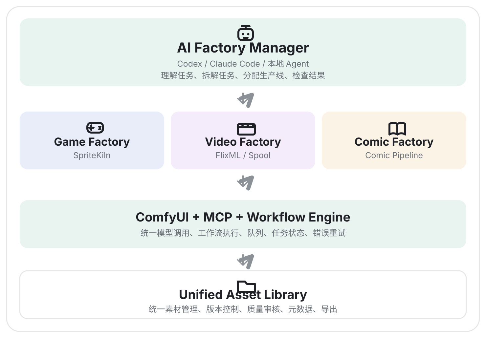
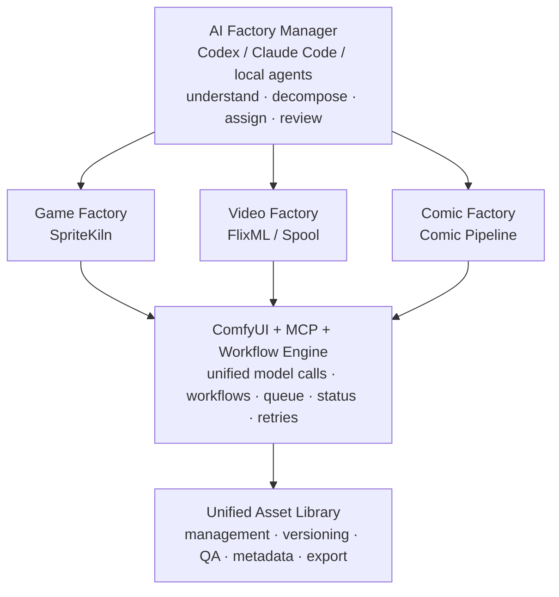

# AI Factory

> Language: **English** | [中文](README.zh-CN.md)

**Build your own AI Factory.** The insight behind this project: you don't need to find a single project that already implements everything — combine the best existing projects into one composable, extensible production platform that agents can operate directly.

Today it produces game assets; tomorrow the same architecture can produce comics, short dramas, ads, marketing images, video, music and sound effects. Every production line can add new models and workflows on its own, without rebuilding the whole system. This repo is a real experiment in finding that architecture — valuable groundwork for Oasis, AI game assets, and global short-drama products.

## Functional architecture





## What the platform is made of

- 🧠 **AI Factory Manager** — Codex / Claude Code / local agents understand a request, break it into steps, assign each step to a production line, and review the results. This is the first module under active development.
- 🎮 **Game Factory** — SpriteKiln: character sprites, tiles, UI and animation frames for games.
- 🎬 **Video Factory** — FlixML / Spool: short dramas, ads and promotional video.
- 📚 **Comic Factory** — Comic Pipeline: panels, pages and serialized comics.
- ⚙️ **ComfyUI + MCP + Workflow Engine** — one interface for model calls and workflow execution, with a shared queue, task state, and automatic error retry. New models/workflows plug in per production line.
- 🗂️ **Unified Asset Library** — one home for all outputs: asset management, version control, quality review, metadata and export.

## Design principles

1. **Compose instead of rewriting** — each production line is a plug-in; the platform supplies the queue, state, retry and asset layer.
2. **Agent-operable** — tasks, steps, runs and results are structured data an agent can read, write and verify.
3. **Extensible per line** — adding a model or workflow to one factory never requires changing the others.
4. **Server-side secrets only** — model keys live in Edge Functions / Vault, never in `VITE_` variables.

## Quick start

```bash
npm install
npm run dev
npm run build   # tsc + vite build
npm run lint    # ESLint
```

Open the dev URL to see the factory map on the home page. Click **AI Factory Manager** to try the working prototype: describe a task, decompose it into steps, assign pipelines, simulate execution, then review each result.

## Repository layout

```
docs/architecture.svg   # functional architecture diagram shown above
supabase/schema.sql     # reference design: tasks / steps / runs / assets
src/
  lib/          # data layer and pure logic (no React)
  components/   # reusable UI
  pages/        # route pages (Home / Manager / Coming Soon)
  styles/       # segmented CSS
AGENTS.md       # rules for agents working in this repo
ARCHITECTURE.md # design notes and planned architecture
```

## Roadmap

- [x] Factory map home page with clickable module cards
- [x] AI Factory Manager prototype (decompose → assign → execute → review)
- [ ] Workflow Engine: unified queue, run state, retry and ComfyUI/MCP adapters
- [ ] Unified Asset Library: versions, QA, metadata, export
- [ ] Real production lines: SpriteKiln / FlixML·Spool / Comic Pipeline
- [ ] Agent automation: Codex / Claude Code / local agents driving the manager

---

[中文](README.zh-CN.md) · **English**
