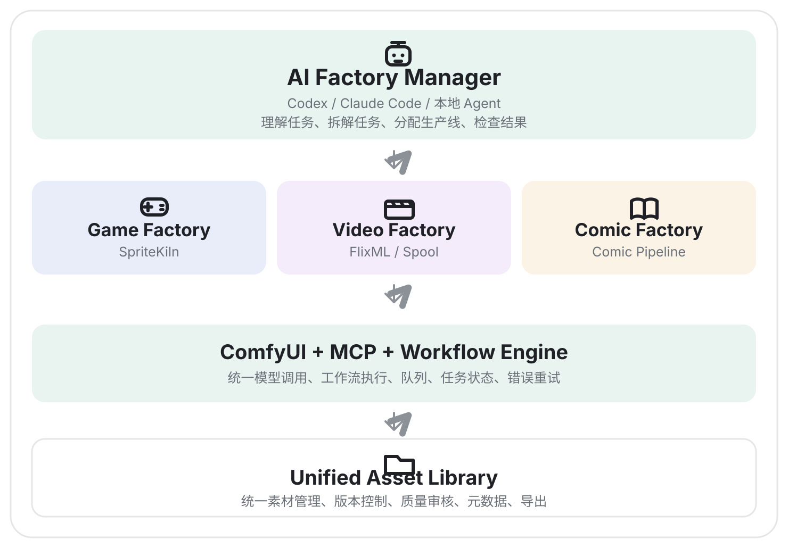
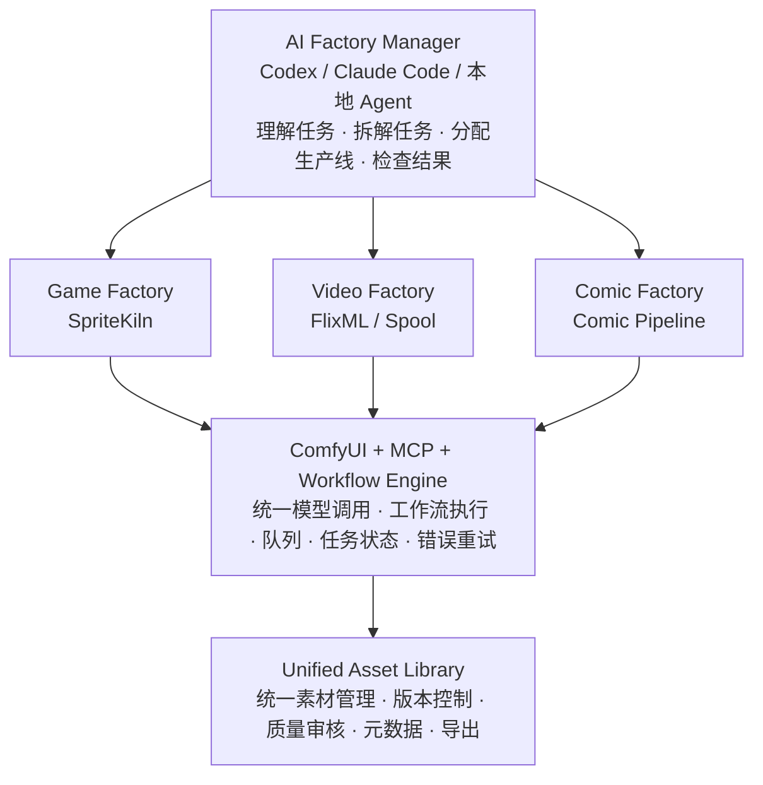

# AI Factory · 搭建自己的 AI Factory

> Language: [English](README.md) | **中文**

**搭建自己的 AI Factory。** 这个项目的核心启发：不一定要找到一个已经实现所有功能的项目——可以把它组合起来，构建一个统一的生产平台，由 Agent 自动操作。

这些项目让我们看到：现在能生产游戏素材，将来同一套架构也能生产漫画、短剧、广告、宣传图片、视频，甚至音乐和音效。而且每条生产线都可以独立增加新的模型和工作流，不必重新开发整个系统。本仓库是一次真正的 AI Factory 项目实验：研究各项目优点，找到一个可组合、可扩展、能够由 Agent 自动操作的生产架构。这对以后做 Oasis、AI 游戏素材以及全球化短剧产品都会很有价值。

## 目标功能结构图





## 平台由哪些部分组成

- 🧠 **AI Factory Manager** —— Codex / Claude Code / 本地 Agent：理解任务、拆解任务、分配生产线、检查结果。当前优先开发这个模块。
- 🎮 **Game Factory** —— SpriteKiln：游戏角色 sprite、图块、UI 与动画帧。
- 🎬 **Video Factory** —— FlixML / Spool：短剧、广告与宣传视频。
- 📚 **Comic Factory** —— Comic Pipeline：分镜、页面与连载漫画。
- ⚙️ **ComfyUI + MCP + Workflow Engine** —— 统一模型调用与工作流执行，共享队列、任务状态与错误重试；新模型/工作流按生产线插拔。
- 🗂️ **Unified Asset Library** —— 统一素材管理、版本控制、质量审核、元数据、导出。

## 设计原则

1. **组合而非重写** —— 每条生产线都是插件；平台提供队列、状态、重试与素材层。
2. **Agent 可操作** —— 任务、步骤、运行与结果都是结构化数据，Agent 可读写与核验。
3. **按生产线扩展** —— 某条产线新增模型或工作流，不影响其它产线。
4. **密钥只在服务端** —— 模型密钥放在 Edge Function / Vault，绝不进 `VITE_` 变量。

## 快速开始

```bash
npm install
npm run dev
npm run build   # tsc + vite build
npm run lint    # ESLint
```

打开开发地址即可看到首页的功能板块图。点击 **AI Factory Manager** 可以体验当前原型：输入任务 → 拆解步骤 → 分配生产线 → 模拟执行 → 检查结果。

## 目录结构

```
docs/architecture.svg   # 上面的功能结构图
supabase/schema.sql     # 参考设计：任务 / 步骤 / 运行 / 素材
src/
  lib/          # 数据层与纯逻辑（不依赖 React）
  components/   # 可复用 UI 组件
  pages/        # 路由页面（首页 / Manager / 敬请期待）
  styles/       # 分段 CSS
AGENTS.md       # Agent 在本仓库的工作规则
ARCHITECTURE.md # 设计说明与规划架构
```

## 路线图

- [x] 首页功能板块图，卡片可点击进入二级页面
- [x] AI Factory Manager 原型（拆解 → 分配 → 执行 → 检查）
- [ ] Workflow Engine：统一队列、运行状态、重试、ComfyUI/MCP 适配器
- [ ] Unified Asset Library：版本、质量审核、元数据、导出
- [ ] 真实生产线接入：SpriteKiln / FlixML·Spool / Comic Pipeline
- [ ] Agent 自动化：Codex / Claude Code / 本地 Agent 驱动 Manager

---

[English](README.md) · **中文**
